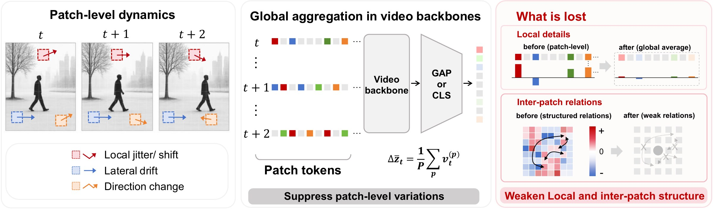
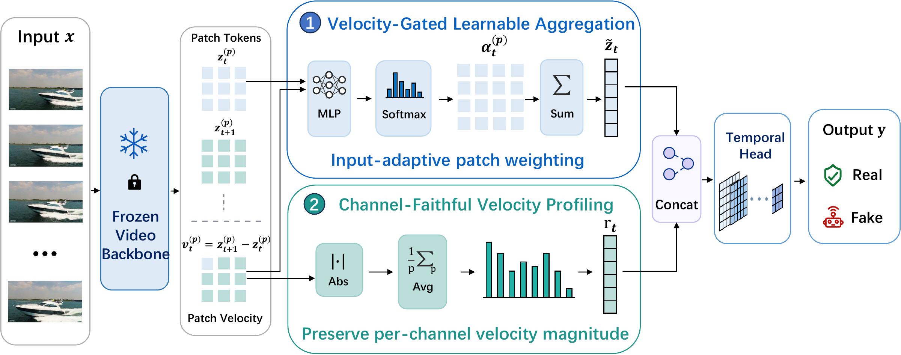

<div align="center">

# 🎞️ Rethinking the Readout

### 释放视频骨干网络在 AI 生成视频检测中的潜力

**V-PVP：速度门控的 Patch 速度刻画（Velocity-Gated Patch Velocity Profiling）**

[Manni Cui](https://manic-cui.github.io/)<sup>1,\*</sup> · Ziheng Qin<sup>2,\*</sup> · ZiAn Wang<sup>3</sup> · Ruiqi Liu<sup>2</sup> · Dianyuan Zou<sup>1</sup> · Jianglan Wei<sup>1</sup> · Han Zhou<sup>1</sup> · Yu Liu<sup>1</sup> · Jingrui Xu<sup>1</sup> · Wenhao Wang<sup>4,†</sup> · Zhenyu Zhang<sup>1,†</sup>

<sup>1</sup>华中科技大学 &nbsp; <sup>2</sup>中国科学院自动化研究所 &nbsp; <sup>3</sup>吉林大学 &nbsp; <sup>4</sup>Vast Intelligence Lab

<sub>\* 共同第一作者 &nbsp; † 通讯作者</sub>

[](https://manic-cui.github.io/projects/rethinking-the-readout/)
[](https://arxiv.org/abs/2607.15321)
[](https://arxiv.org/abs/2607.15321)
[](https://www.python.org/)
[](https://pytorch.org/)
[](LICENSE)
[](https://github.com/manic-cui/Rethinking-the-readout)

[English](README.md) · [简体中文](README_zh-CN.md)

[🌐 项目主页](https://manic-cui.github.io/projects/rethinking-the-readout/) · [📄 论文](https://arxiv.org/abs/2607.15321) · [🧭 方法](#-方法) · [📊 实验结果](#-实验结果) · [🚀 快速开始](#-快速开始) · [📚 引用](#-引用)



</div>

---

> **一句话总结：** 视频骨干网络在 AI 生成视频检测上表现不佳，问题不在骨干本身，而在 readout（读出层）。只把 GAP/CLS readout 换成 **V-PVP**（约 0.5M 可训练参数），**完全冻结**的 VideoMAE 就能在 AIGVDBench 上达到 **95.28 AUC**。

AI 生成视频（AIGV）中的伪影往往来自帧与帧之间的不一致，而不是单帧内部，因此视频预训练骨干理应更有优势。但实际上，使用标准全局 readout 的视频骨干常常比不过强大的图像预训练模型。我们把这一差距归因于 readout 中过度的时空聚合：把每一帧压缩成单个全局描述子，会抑制 patch 级的时序动态，并丢弃 patch 之间的关系，而这些正是 AIGV 检测最可靠的线索。

**V-PVP** 保持骨干网络冻结，只把聚合层替换为作用在 patch 速度场上的两条并行支路。它可以作为即插即用的 readout 用于不同的视频骨干，在端到端微调和线性探测两种设置下都有效。

---

## 📰 动态

- **2026.09** &nbsp;论文被 **NeurIPS 2026** 接收。
- **2026.07** &nbsp;论文公开于 [arXiv](https://arxiv.org/abs/2607.15321)。
- **2026.05** &nbsp;发布代码和 V-PVP head 权重。

---

## ✨ 亮点

| | |
|---|---|
| 🎯 **瓶颈在 readout** | GAP/CLS readout 抹掉了 patch 之间的关系，并稀释了逐通道的速度幅值；骨干表征本身已经包含了判别信号 |
| 🧊 **骨干完全冻结** | VideoMAE 完全冻结时在 AIGVDBench 上达到 **95.28** mga AUC，超过标准 readout 下的端到端微调（88.34） |
| 🪶 **轻量** | 仅 492,674 个可训练参数（约 0.5M） |
| 🔌 **即插即用** | 在 TimeSformer、VideoMAE、UniFormerV2 和 Qwen3-VL-8B 上均有提升，也能叠加在 LoRA 和全参数微调之上 |
| 🏆 **两个基准第一** | AIGVDBench（20 个生成器）95.28，GenVidBench-143k 93.75 |

---

## 🧭 方法

<div align="center">

</div>

冻结的视频 Transformer 输出 patch token $z \in \mathbb{R}^{B \times P \times T' \times D}$。标准 readout 在读取时间变化之前就先做了池化，造成两类损失：

- **损失 1：patch 之间的关系被抹掉。** 生成视频的 patch 速度矩阵具有系统性更高的谱条件数（Cohen's $d \approx 0.64$），聚合之后这一信号就无法再被测到。
- **损失 2：逐通道的速度幅值被稀释。** 池化前真实与生成视频的逐通道速度能量为 1.00 vs 0.80（$d \approx 0.69$），池化后差距缩小为 1.00 vs 0.88（$d \approx 0.41$）。

V-PVP 从 patch 速度场出发：

$$v_t^{(p)} = z_{t+1}^{(p)} - z_t^{(p)}$$

并通过两条并行支路读取它：

1. **速度门控的可学习聚合**（应对损失 1）。一个小型 MLP 根据每个 patch 的 token 和速度幅值为其打分：

$$\alpha_t^{(p)} = \mathrm{softmax}_p\big(\mathrm{MLP}([\,z_t^{(p)},\ \lVert v_t^{(p)} \rVert_2\,])\big), \qquad \tilde z_t = \sum_p \alpha_t^{(p)} z_t^{(p)}$$

2. **保真逐通道的速度支路**（应对损失 2）。在空间平均之前先取绝对值，避免符号相反的分量相互抵消：

$$r_t = \frac{1}{P}\sum_p \big|v_t^{(p)}\big|$$

两条支路分别线性投影到 128 个通道后拼接，再经过 GELU → Conv1D (k = 3) → GELU → 沿 $t$ 取平均 → Dropout(0.3) → Linear，每个视频输出一个 logit。骨干网络始终不更新。

---

## 📊 实验结果

AIGVDBench 开源划分（20 个生成器）和 GenVidBench-143k（跨来源协议）上的平均 AUC（%）。V-PVP 使用冻结的 VideoMAE-B/16；VideoMAE 一行是同一骨干在标准 readout 下端到端微调的结果。数字来自论文表 1 和表 2。

| 类别 | 方法 | AIGVDBench | GenVidBench-143k |
|---|---|---:|---:|
| AI 生成图像检测方法 | NPR | 89.90 | 50.26 |
| | UnivFD | 90.03 | 78.76 |
| | Effort | 90.29 | 79.08 |
| | DDA | 90.73 | 92.79 |
| | MIRROR | 66.57 | 75.81 |
| AI 生成视频检测方法 | DeMamba | 93.14 | 90.03 |
| | DeCoF | 92.20 | 73.30 |
| | ReSTrav | 69.27 | 90.28 |
| | NSG-VD | 52.55 | 69.22 |
| 视频分类模型 | I3D | 92.85 | 92.76 |
| | SlowFast | 92.70 | 92.95 |
| | TimeSformer | 85.41 | 91.18 |
| | UniFormerV2 | 76.46 | 69.87 |
| | VideoMAE | 88.34 | 88.59 |
| **本文** | **V-PVP（冻结 VideoMAE）** | **95.28** | **93.75** |

**V-PVP 可以与骨干适配方法叠加**（AIGVDBench 上 VideoMAE 的 mga AUC，论文表 4）：

| 适配方式 | 可训练参数 | 标准 readout | V-PVP | Δ |
|---|---:|---:|---:|---:|
| 冻结 | ~0.5M | 89.82 | **95.28** | +5.5 |
| LoRA (r = 8) | ~1M | 88.22 | **95.06** | +6.8 |
| 全参数微调 | ~87M | 88.34 | **97.21** | +8.9 |

逐生成器结果、消融实验以及其他骨干上的结果请见论文。

---

## 📦 已发布的权重

| 文件 | 骨干 | 协议 | mga AUC |
| ---- | ---- | ---- | ------: |
| `pvp_heads/videomae_k400_vpvp.pt` | VideoMAE-B/16 K400，冻结 | AIGVDBench，20 个生成器的 Open-Source 测试划分 | **0.9528** |
| `pvp_heads/genvidbench_videomae_auc0.9375.pt` | VideoMAE-B/16 K400，冻结 | GenVidBench-143k 跨来源协议 | **0.9375** |

两个 head 都是 `PVPHead("velocity_gated", D=768)` 的 `state_dict`（`src/pvp_head.py`，492,674 个参数），训练时骨干完全冻结（不使用 LoRA，也不微调）。`eval_opensource.py` 实现了 AIGVDBench Open-Source 评测（3000 个真实视频 + 60000 个生成视频，共 63000 个）；GenVidBench head 的说明见 [`checkpoints/README.md`](checkpoints/README.md)。

---

## 🚀 快速开始

### 1. 安装

```bash
git clone https://github.com/manic-cui/Rethinking-the-readout.git
cd Rethinking-the-readout
python -m pip install -r requirements.txt
```

已在 Python 3.13、`torch` 2.x 和 `transformers` 4.x / 5.x 下测试。VideoMAE 封装会自行加载权重，并把注意力偏置重排为当前 `transformers` 版本的布局，因此两个大版本得到的特征完全一致。

### 2. 骨干权重

V-PVP 使用公开的、在 Kinetics-400 上微调过的 VideoMAE-Base 权重：
[`MCG-NJU/videomae-base-finetuned-kinetics`](https://huggingface.co/MCG-NJU/videomae-base-finetuned-kinetics)。
请把该仓库下载为一个包含 `config.json`、`preprocessor_config.json` 和 `model.safetensors` 的文件夹，并通过 `--backbone_weights` 传入。

Patch token 取自最后一个 Transformer block 的输出、任何最终归一化之前（该权重使用 `use_mean_pooling=True`，编码器没有最终的 LayerNorm）。输入 16 帧、`tubelet_size=2` 时，每个空间 patch 有 `T' = 8` 个时间 token，即 head 使用 7 个速度步。

### 3. 数据

把 AIGVDBench 的帧文件夹按如下结构放在同一个根目录下：

```
<DATA_ROOT>/
├── Real/test/Real/videos/<vid>/frame_NNN.jpg
└── OpenSource/
    ├── T2V/<gen>/test/videos/<vid>/frame_NNN.jpg
    ├── I2V/<gen>/test/videos/<vid>/frame_NNN.jpg
    └── V2V/<gen>/test/videos/<vid>/frame_NNN.jpg
```

`<gen>` 是生成器名称（如 `Wan2.1`、`Cogvideox1.5` 等）；20 个生成器文件夹组成 Open-Source 划分，评测报告中的类别按模态命名（如 `T2V/Wan2.1`）。每个 `<vid>` 文件夹存放一个视频的帧图像，按文件名排序；`--num_frames` 会在现有帧中均匀采样，因此所有视频请使用相同的抽帧方式。

### 4. 运行评测

```bash
cd src

python eval_opensource.py \
    --backbone         videomae_k400 \
    --backbone_weights /path/to/videomae-base-finetuned-kinetics \
    --head_ckpt        ../checkpoints/pvp_heads/videomae_k400_vpvp.pt \
    --data_root        /path/to/aigvdbench \
    --num_frames       16 \
    --batch_size       32 \
    --out_json         ../results/videomae_open_source.json
```

这会复现论文表 1 中 V-PVP 的结果（mga AUC 0.9528）。脚本会打印总体和逐生成器的 AUC；指定 `--out_json` 时还会把完整的逐生成器结果写入 JSON 文件。

### 5. 在自己的代码中加载 head

```python
import torch
from src.pvp_head import PVPHead

head = PVPHead("velocity_gated", D=768)
head.load_state_dict(torch.load("checkpoints/pvp_heads/videomae_k400_vpvp.pt",
                                map_location="cpu"))
head.eval()
```

head 的输入是形状为 `(B, P, T', D)` 的 VideoMAE patch token。

---

## 🗂️ 仓库结构

```
.
├── README.md
├── README_zh-CN.md
├── LICENSE
├── requirements.txt
├── assets/                      README 中使用的图片
├── src/
│   ├── pvp_head.py              V-PVP head（VelocityGatedAttn + PVPHead）
│   ├── dataset.py               AIGVDBench Open-Source 测试划分的帧加载器
│   ├── eval_opensource.py       评测入口
│   └── backbones/
│       ├── __init__.py          BACKBONE_REGISTRY
│       ├── base.py              FrozenVideoBackbone 接口
│       └── videomae_k400.py     冻结的 VideoMAE-B/16 K400 封装
└── checkpoints/
    ├── README.md
    └── pvp_heads/
        ├── videomae_k400_vpvp.pt
        └── genvidbench_videomae_auc0.9375.pt
```

---

## 📚 引用

如果这项工作对你有帮助，欢迎引用：

```bibtex
@inproceedings{cui2026rethinking,
  title     = {Rethinking the Readout: Unlocking Video Backbones for {AI}-Generated Video Detection},
  author    = {Cui, Manni and Qin, Ziheng and Wang, ZiAn and Liu, Ruiqi and Zou, Dianyuan and Wei, Jianglan and Zhou, Han and Liu, Yu and Xu, Jingrui and Wang, Wenhao and Zhang, Zhenyu},
  booktitle = {Advances in Neural Information Processing Systems (NeurIPS)},
  year      = {2026}
}
```

---

## 📬 联系方式

- **Issues** &nbsp;[github.com/manic-cui/Rethinking-the-readout/issues](https://github.com/manic-cui/Rethinking-the-readout/issues)
- **邮箱** &nbsp;`mannicui@berkeley.edu`
- **个人主页** &nbsp;[manic-cui.github.io](https://manic-cui.github.io/)

---

## ⚖️ 许可证

代码以 [MIT 许可证](LICENSE) 发布。VideoMAE 骨干权重不包含在本仓库中，其使用遵循各自的许可证。
